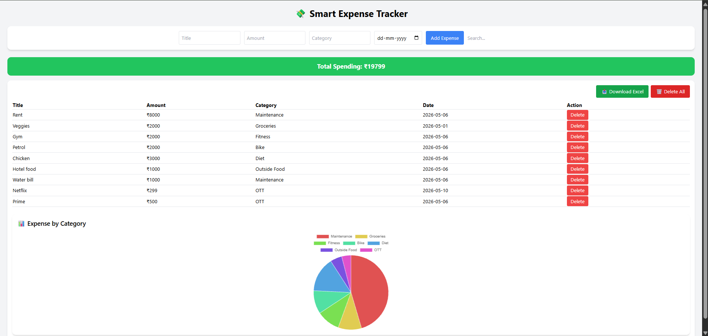
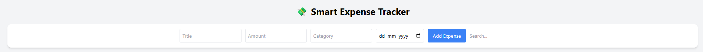
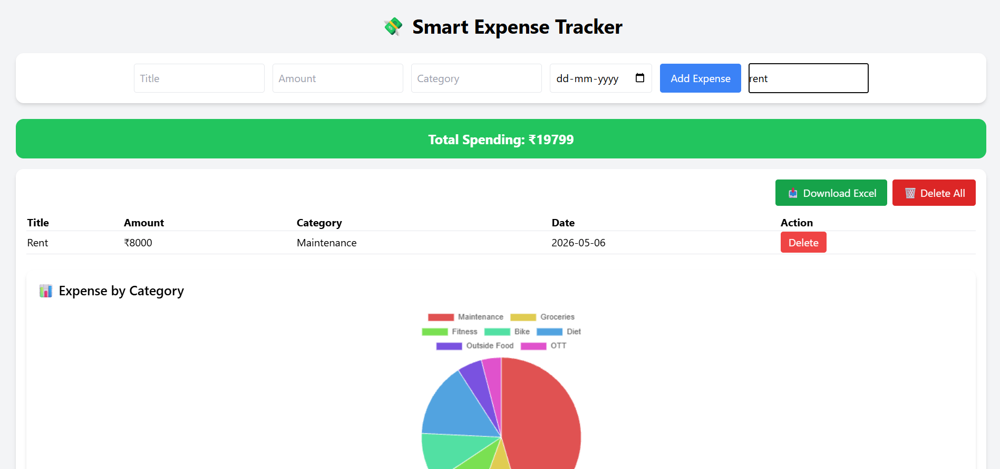
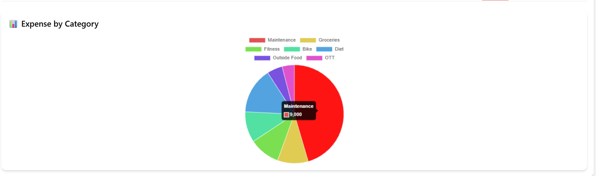
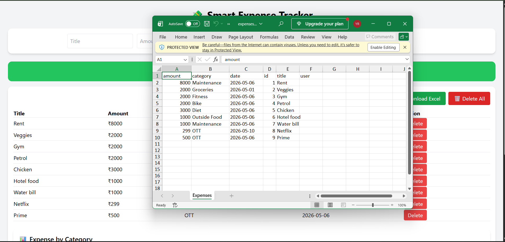

# Dashboard User Guide

## Introduction

The Smart Expense Tracker dashboard provides users with an interface to record, search and review their personal expenses.

Users can add expense records, view their spending summary, analyze expenses by category, search existing records and export expense information to an Excel file.

This guide explains how to use the available dashboard features.

## Accessing the Dashboard

*Figure 1: Smart Expense Tracker dashboard.*

1. Open Smart Expense Tracker in your browser.
2. Navigate to the login page.
3. Enter your registered email address and password.
4. Submit the login form.
5. After successful authentication, access the dashboard.

**Note:** The dashboard requires a registered user account.

## Understanding the Dashboard

The dashboard provides access to the application's expense management functionality.

The main capabilities include:

- Adding new expenses.
- Viewing expense records.
- Searching expenses by title.
- Reviewing total spending.
- Viewing category-wise spending distribution.
- Exporting expense records.
- Deleting expense records.

## Adding an Expense

*Figure 2: Add Expense to the List.*

Use the expense form to record a new expense.

### Procedure

1. Open the dashboard.
2. Locate the expense entry form.
3. Enter the expense title.
4. Enter the expense amount.
5. Select or enter the expense category as supported by the interface.
6. Select the expense date.
7. Submit the form.

### Expected Result

The application submits the expense information to the backend. When the operation succeeds, the expense should appear in the dashboard's expense records.

## Viewing Expense Records

The dashboard displays the expense records available to the logged-in user.

Review the displayed information to identify the recorded expenses.

The information associated with an expense includes:

- Expense title.
- Amount.
- Category.
- Date.

## Searching for an Expense

Use the search functionality to find an expense by its title.

*Figure 3: Smart Expense Tracker Expense Search.*

### Procedure

1. Locate the search field on the dashboard.
2. Enter the title or a matching portion of the title.
3. Review the filtered expense records.

### Expected Result

The dashboard displays the expense records matching the entered search text.

**Note:** The current implementation performs title-based searching in the frontend.

## Reviewing Total Spending

The dashboard displays a total spending value calculated from the available expense records.

Use this summary to review the total amount represented by the displayed expense data.

## Understanding the Category Chart

*Figure 4: Category Chart.*

The dashboard includes a pie chart that visualizes expense distribution across categories.

The chart helps users understand how their recorded expenses are distributed among different categories.

Review the category segments to identify the relative contribution of each category to the recorded expenses.

## Exporting Expense Records

*Figure 5: Exporting Data to Excel.*

Users can download their expense records as an Excel file.

### Procedure

1. Open the dashboard.
2. Locate the Excel export option.
3. Select the export option.
4. Check the downloaded file.
5. Open the file using a compatible spreadsheet application.

### Expected Result

An Excel file containing the exported expense information is downloaded to the user's device.

## Deleting an Individual Expense

Users can remove an individual expense record from the dashboard.

### Procedure

1. Locate the expense record.
2. Select its delete option.
3. Complete any confirmation step presented by the application, if applicable.
4. Check the updated expense list.

### Expected Result

The selected expense is removed if the delete operation succeeds.

## Deleting All Expenses

The dashboard also provides an option to delete all expense records.

**Warning:** This operation may permanently remove the user's expense records. Review the records carefully before proceeding.

### Procedure

1. Locate the delete-all option.
2. Review the action before selecting it.
3. Complete any confirmation step presented by the application, if applicable.
4. Check the updated dashboard.

### Expected Result

The expense list is cleared if the delete operation succeeds.

## Related Documentation

- [Product Overview](../product-overview.md)
- [Installation Guide](../getting-started/installation.md)
- [API Overview](../api/overview.md)
- [Troubleshooting](../troubleshooting/common-issues.md)
